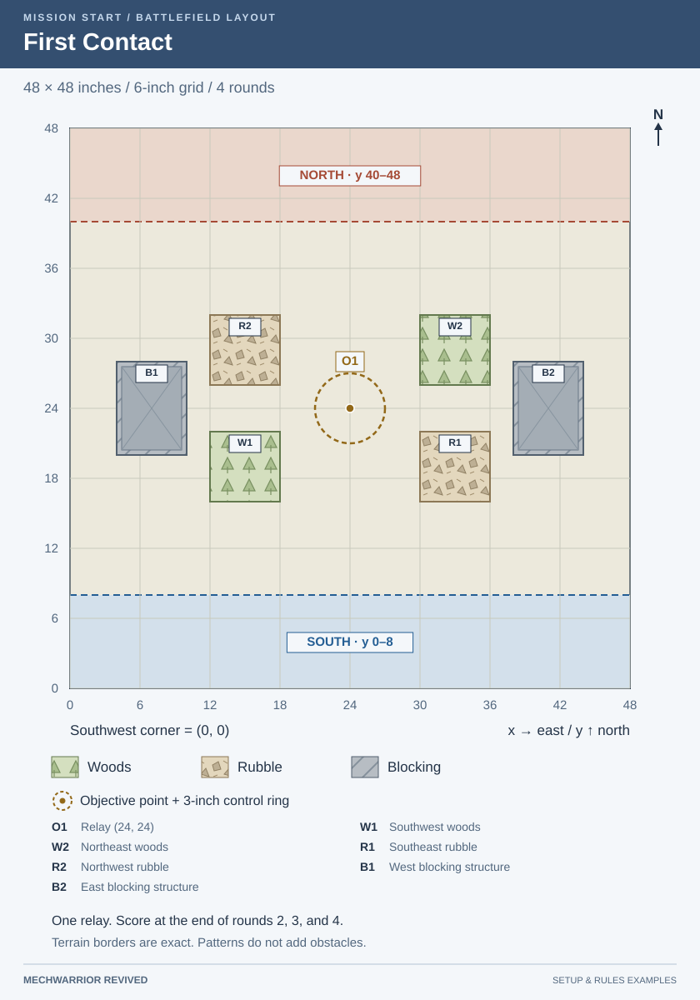

# Dead Air

**The Fight for Kestrel Relay**

For six days, the valley has heard nothing but static. Kestrel Relay is the last working link between the mining settlements and the outside world. Now its maintenance beacon has begun transmitting again. Two patrols have picked up the signal. Neither intends to leave the station to the other.

[Download the complete playtest pack](dead-air-playtest-pack.pdf) · 16 Letter pages · Print at 100%, single-sided

## The two patrols

### Kestrel Watch

The settlements pooled their remaining machines and hired whoever would answer. Get a crew onto the relay and keep the channel open. The valley needs a way to call for help, and your patrol is all it can afford to send.

**594 points · 7 models · 5 activation groups.** Uses the existing Patrol A roster, with callsigns and named pilots.

[Load Patrol A in the builder](../site/builder.html?sample=S1) · [Download the themed list](dead-air-s1.json)

### Blackwire Recovery

Your employer claims the relay under an old salvage contract. Secure the site before the local militia can bring it online. The transmitter must survive; the people defending it are a problem your employer has left to you.

**590 points · 7 models · 5 activation groups.** Uses the existing Patrol B roster, with callsigns and named pilots.

[Load Patrol B in the builder](../site/builder.html?sample=S2) · [Download the themed list](dead-air-s2.json)

Both are mixed-faction contract patrols. Their actual model factions remain on the rosters and cards. The setting, callsigns and pilot names are original fan fiction; they add no rules or bonuses. Import a themed list in the builder to use its name, or load the matching starter patrol directly.

## Inside the pack

| Pages | Contents |
| --- | --- |
| 1 | Mission briefing and how to run the two games |
| 2 | Measured relay map, terrain key and deployment |
| 3 | Both rosters, exact model IDs, factions and points |
| 4–6 | Turn reference, equipment used by these patrols, and DFA |
| 7–10 | Kestrel Watch: seven photo cards with full combat and heat dials |
| 11–14 | Blackwire Recovery: seven photo cards with full combat and heat dials |
| 15 | Six assigned pilot cards |
| 16 | One-page results sheet; print two copies |

## Set up and play

Use [First Contact](../scenarios/00-first-contact.md) exactly as written: a 48 × 48 inch table, four rounds, and a relay scored at the end of rounds 2, 3 and 4. Higher score wins; equal scores draw. Kills do not score. Either patrol can use either edge.

The printed pack gives the same terrain footprints local names: shelterbelts, ruined buildings and industrial blocks. The relay is a point marker, not a building. The map is a setup guide, not a table-sized play mat.

Keep the [core rules](../rules/core-rules.md) and [equipment reference](../rules/equipment-reference.md) nearby. The PDF's field sheets are quick references. Infantry start on foot; neither vehicle is a carrier. Use clearly labeled stand-ins with the exact cards if needed.

## Play the return game

Keep your force, swap north and south, and reset all dials and markers. Use the same PDF for both games. Record the score, time, vehicle and squad orders, decisions changed by heat or pushing, and rules that needed rereading. Save proposed rule and points changes until both games are finished.

Pack 1 · Rules 0.3 · Points 0.3-alpha-5 · Snapshot `7b66f15d4c`. The snapshot identifies the rules and roster data used to build this copy. No tabletop results have been recorded for this matchup.
