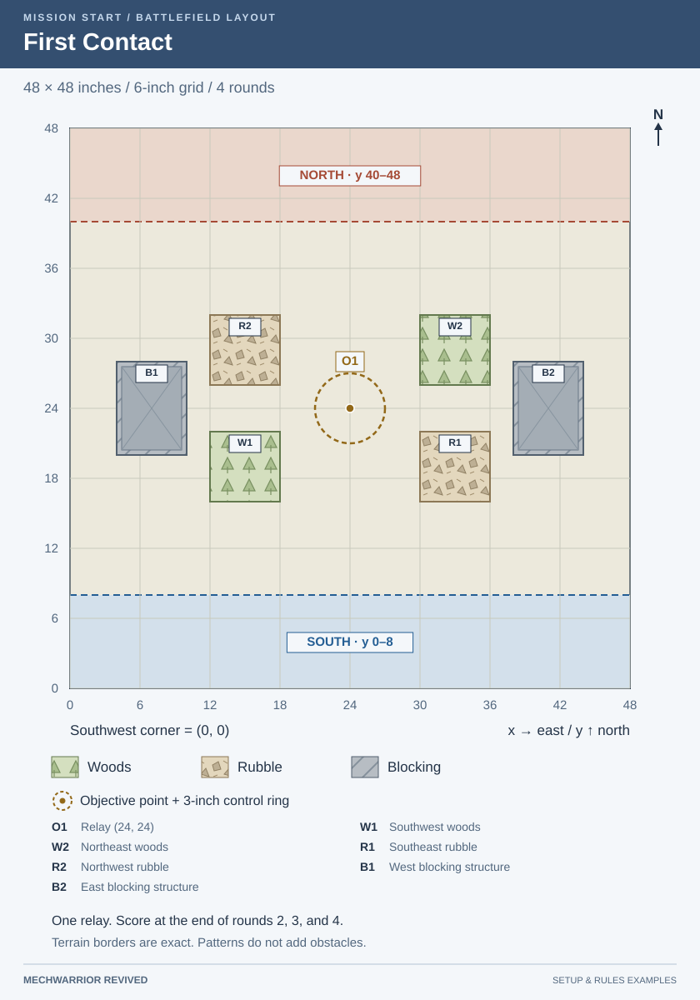
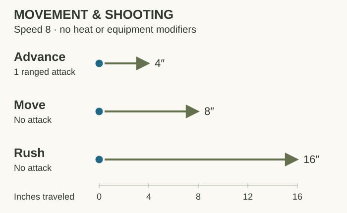
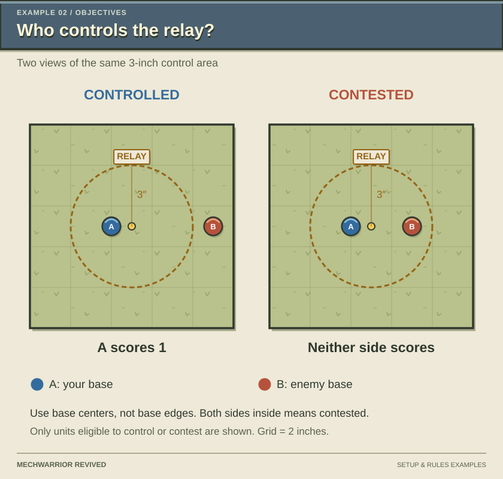
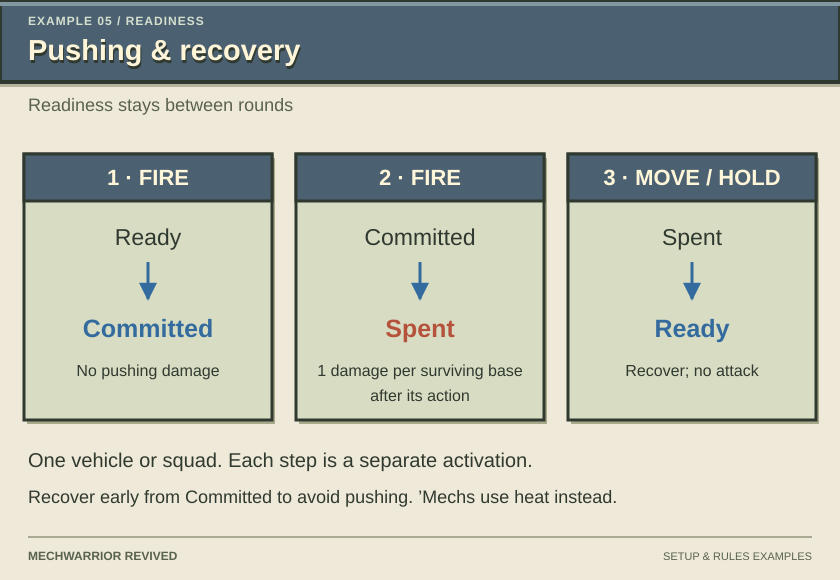

# First Contact

Starter scenario · Two players · 600 points each · 48 × 48 inches · 4 rounds · Version 0.3

Two patrols reach a relay station at the same time. Get troops onto the site, keep the enemy away, and hold it while your weapons and engines wear down.

This is a first game using the normal rules. One objective and four rounds keep the mission simple. The map and examples below show setup, movement, objective control, and pushing.

## Choose your patrols

Use the two [starter patrols](../playtest/starter-forces.md), with seven models and five activation groups each. [Load Patrol A](../site/builder.html?sample=S1) or [Patrol B](../site/builder.html?sample=S2) in the builder, then choose **Generate unit cards**. You can also bring your own legal [600-point Skirmish force](../rules/core-rules.md#force-organization).

The starter lists have infantry on foot and no Rocket substitutes. Keep the [turn reference](../rules/turn-reference.md), [equipment reference](../rules/equipment-reference.md), and [pilot cards](../pilots/pilot-cards.md) nearby. Set combat and heat dials to Start. Vehicles and squads begin Ready.

## Set up the map

Use a **48 × 48 inch** table. The southwest corner is (0, 0); x runs east and y runs north. Each grid square below is **6 inches**. The circles and arrows in the teaching diagrams are examples, not extra terrain.

*Open the map for a full-size view or print it as a setup guide. It is not a table-sized play mat. The dashed ring marks the relay’s 3-inch control radius.*

| Feature | Position in inches |
| --- | --- |
| Relay objective | Point (24, 24) |
| South deployment | Full width, y 0–8 |
| North deployment | Full width, y 40–48 |
| W1 · Southwest woods | x 12–18, y 16–22 |
| W2 · Northeast woods | x 30–36, y 26–32 |
| R1 · Southeast rubble | x 30–36, y 16–22 |
| R2 · Northwest rubble | x 12–18, y 26–32 |
| B1 · West blocking structure | x 4–10, y 20–28 |
| B2 · East blocking structure | x 38–44, y 20–28 |

Mark terrain edges with paper or felt if you do not have scenery. Everything outside those footprints is open ground. The relay marker is a point, not a building or an obstacle; leave its control area open. Use the normal terrain rules for woods, rubble, and blocking structures.

Roll one die each, rerolling ties. The winner chooses north or south. The other player deploys one group first; alternate until both patrols are placed. Keep each entire base inside its zone, and infantry in their 4-inch chain. Either patrol can take either side. Infiltrate follows its equipment rule after ordinary deployment.

## Play and score

At the start of every round, roll initiative normally. Alternate group activations until everything has acted. Mark activations separately from heat and readiness.

At the end of **rounds 2, 3, and 4**, score **1 point** if you control the relay. You control it when at least one of your base centers is within **3 inches** and no enemy base center is. If both sides are inside, it is contested and neither scores. Round 1 scores nothing.

After round 4, the higher score wins. Equal scores are a draw. Kills do not score or break ties. There are **3 points available across both players**. Wiping out a patrol does not end play; if neither side has units left, use the core early-ending rule.

| Round | South score | North score |
| --- | --- | --- |
| 1 | No scoring | No scoring |
| 2 | ___ | ___ |
| 3 | ___ | ___ |
| 4 | ___ | ___ |
| Total | ___ | ___ |

## Moving and shooting

This example uses **speed 8 with no heat or equipment modifiers**. You may move less. Measure the route traveled and pay terrain costs. Other speeds use the same rules: halve and round up for Advance, full speed for Move, twice speed for Rush.

Advance has no general attack penalty. A Ballistic shot after moving or turning has −1 recoil unless Gunner removes it. An Energy attack adds 1 extra ’Mech heat. Rockets shoot only with Fire. Check range, arc, and line of sight after moving; an Advance does not guarantee a legal shot.

For a ’Mech, Advance costs 2 heat, Move 1, and Rush 1, plus the extra heat if it rolls an Energy attack. For vehicles and infantry, Advance commits or pushes; Move recovers; Rush leaves readiness unchanged and is not allowed while Spent.

## Holding the relay

Check **base centers**, not base edges. A friendly base inside the ring and an enemy outside means you control the relay. If an enemy center is also inside, neither side scores, even if one side has more models there.

Spent units can still control or contest. Shutdown ’Mechs and passengers cannot. A unit does not need to fire to help win the game.

## Pushing or recovering

This example is for a **vehicle or infantry squad**, starting Ready. Each step happens on a separate activation. A first Fire commits it. A second Fire pushes: finish each base’s attack, then give each surviving base 1 unavoidable damage. It is now Spent and must recover on its next activation.

You can recover early: **Fire, then Move or Hold** returns the group to Ready without pushing damage. Recovery does not repair the dial. Use Hold if engaged, or follow the normal Disengage rules. ’Mechs use heat instead of this readiness sequence.

## Your first four rounds

These are prompts, not required orders. Keep making your own choices.

1. **Approach.** Try Move or Rush toward the relay or cover. Check the whole base fits along the route. Move recovers non-’Mechs; Rush does not.
2. **Make contact.** Choose between firing from cover and advancing toward the relay. Check the target before rolling. Mark Committed after a vehicle or squad’s first combat order. Score the relay after all groups act.
3. **Manage the cost.** Decide whether to push, recover, or Vent a ’Mech. Read the current dial after damage or heat changes. Score the relay again.
4. **Contest the site.** A Move can recover a vehicle or squad and put it in control range. Check who can still contest, finish every activation, then score the last point.

Readiness and heat stay between rounds. Clearing the “has acted” marker does not clear either track.

## Play again

Keep the armies and terrain, swap deployment sides, and play another four rounds. Note whether the relay was reachable, when heat or pushing changed a decision, and how long the game took. The starter matchup has not yet been tested on the table.

Next try [Seize and Hold](01-seize-and-hold.md) for three objectives, six rounds, and more choices about where to commit your force.
