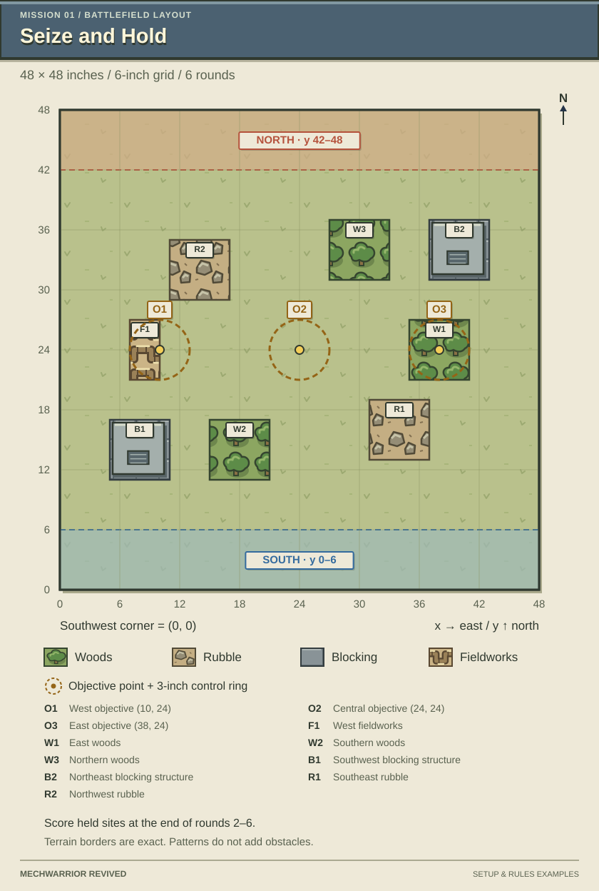

# Seize and Hold

Two players · Any listed game size · 6 rounds · Version 0.3

Hold three relay sites and score points each round. Use the [core rules](../rules/core-rules.md) for objective control.

## Set up

Agree on a [game size](../rules/core-rules.md#choose-the-battle-size), then place terrain and objectives as shown. Use the wider map for Large or Grand Battles.

Staggered relay buildings screen the advance from both edges. The central site stays exposed; the outer sites offer different kinds of infantry cover. Keep the marked blocking footprints even if your scenery is smaller.

Deploy with bases entirely inside the north or south zone shown on the map. Use the normal side-choice and alternating deployment rules. Choose sides after placing terrain; leave the center objective in open ground. Infiltrate follows its equipment rule after ordinary deployment.

Vehicles and ’Mechs can contest the western site from outside the fieldworks if their centers are within 3 inches. They cannot enter the fieldworks.

## Score and win

At the end of rounds **2–6**, score 1 point for each objective you control. Contested objectives score nothing. Round 1 scores nothing. There are 15 points available across both players.

> **Example:** You hold two sites and the third is contested at the end of round 2. You score 2; your opponent scores 0. Holding those same two next round scores another 2.

After round 6, the higher score wins. Equal scores are a draw; kills do not break ties.

Wiping out an army does not end the game. Keep playing and scoring. If neither army has any units left, use the core early-ending rule.

## Live sites (optional)

Agree to use [special terrain](special-terrain.md) before choosing armies. The three objective points on the map become working installations:

- **O1, west: Smoke generator.** Operate it to block direct fire around the fieldworks until the next round.
- **O2, center: Uplink.** Operate it to claim the exposed objective, then move on while the claim holds it.
- **O3, east: Coolant station.** Operate it to cool one friendly ’Mech near the woods.

Keep the same map, deployment, and scoring at every game size. All three sites still score 1 point each at the end of rounds 2–6, for 15 available points. Operating them gives no extra points. Only the uplink can remain controlled without a unit nearby.

> **Example:** Blue operates O2 in round 2, scores it, then leaves in round 3. If no enemy takes control, the claim scores O2 again at the end of round 3. Blue still needs models at O1 and O3 to score those sites.

## Play again

Keep the armies and map, but put each army on the opposite edge. Players may also exchange armies. Roll initiative normally.

Compare infantry in fieldworks, infantry in woods, and units fighting over the open center. Note which units changed control, even if they dealt no damage.
