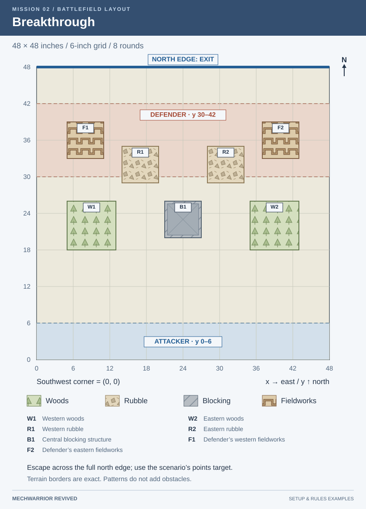

# Breakthrough

Two players · Any listed game size · 8 rounds · Version 0.3

The attacker must get enough of the army past the defender and off the north edge.

## Set up

Agree on a [game size](../rules/core-rules.md#choose-the-battle-size), then place terrain as shown. Use the wider map for Large or Grand Battles. Roll to choose attacker and defender.

The defender deploys first, then the attacker. Keep each base entirely inside its marked zone. Keep squads together and use legal terrain. Infiltrate follows its equipment rule after ordinary deployment.

The attacker chooses who acts first in round 1. Roll initiative normally afterward. The whole north edge is the exit.

## Escape

Before play, calculate **30% of the attacker’s actual starting points, rounded up**. This is the escape target. A 1,200-point army needs 360 escaped points.

An unengaged attacker may leave with Move, Advance, or Rush, using that action’s movement allowance and costs. Move lets a Spent group recover and exit. Advance is half speed and still commits or pushes non-’Mechs, even without a shot. Pay pushing damage before scoring; a unit destroyed by it scores nothing. Move the entire base over the north edge, paying enough movement for its back edge to clear the table. It cannot attack that activation. No other edge is an exit; shutdown units cannot leave.

Remove escaped units permanently and count their points once, using the cost recorded before deployment. Passengers leave with their carrier and add their points, even if their squad has already acted. Destroyed units score nothing.

A squad leaving on foot must get every survivor across with the same action in the same activation. Declare the exit before moving. If any member cannot make it, none leaves; choose a normal squad action instead. A split squad must spend an activation regrouping first; it cannot exit during that activation.

## Win

The attacker wins as soon as the escaped total reaches the target. Otherwise the defender wins at the end of round 8.

If all attackers are destroyed or have escaped, check the total immediately and end the game. Record an unfinished or abandoned game as such.

## Play again

Keep the map and exchange army roles: the former defender attacks from the south; the former attacker defends the north.

Record transport use, passenger losses, escaped points by unit type, and time spent waiting for the other player to finish activating.
