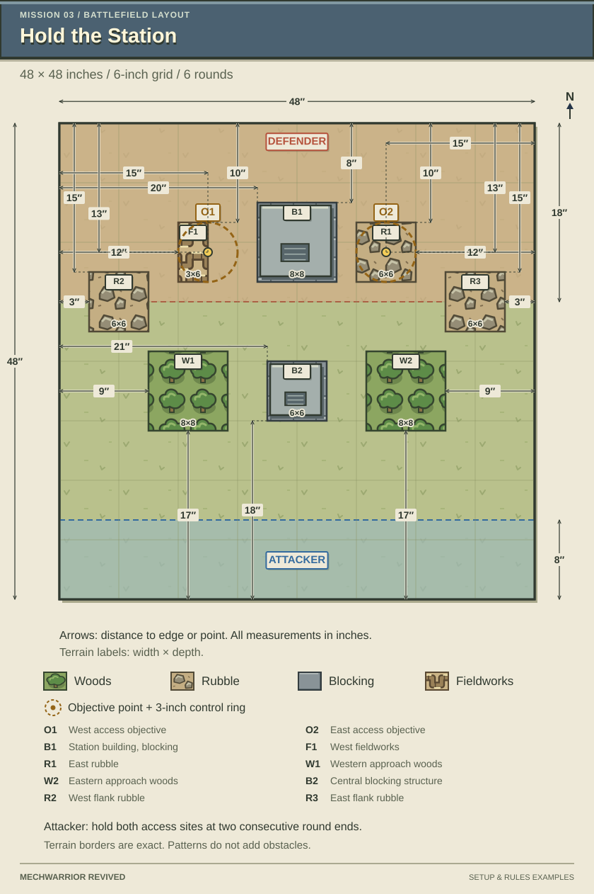

# Hold the Station

Two players · Any listed game size · 6 rounds · Version 0.3

The attacker must hold both access sites long enough to capture a communications station. The building is terrain; it cannot attack or be destroyed.

## Set up

Agree on a [game size](../rules/core-rules.md#choose-the-battle-size), then place terrain and objectives as shown. Use the wider map for Large or Grand Battles. Roll to choose attacker and defender.

Two staggered lines of buildings shelter the approach. The station blocks sight between the two access sites. Keep the marked blocking footprints even if your scenery is smaller.

The defender deploys first, then the attacker. Keep each base entirely inside its marked zone. Keep squads together and use legal terrain; vehicles and ’Mechs cannot enter fieldworks or the station. Infiltrate follows its equipment rule after ordinary deployment.

The attacker chooses who acts first in round 1. Roll initiative normally afterward. There are no reserves.

## Capture the station

At each round end, check both access objectives using the core control rules.

- If the attacker controls **both**, add 1 to the capture counter.
- If either is contested, uncontrolled, or held by the defender, reset the counter to 0.

The attacker wins at **2 consecutive round ends** with both sites held. Otherwise the defender wins at the end of round 6. First taking both sites in round 6 is too late.

> **Example:** The attacker holds both sites after round 3: counter 1. One is contested after round 4, resetting it to 0. Holding both after rounds 5 and 6 then wins the game.

Passengers and shutdown ’Mechs do not contest. Entering the attacker’s deployment zone gives the defender no special victory.

Eliminating the defender does not replace the capture requirement. If neither side has units left, the defender wins. A single surviving base cannot hold both sites at once.

## Play again

Keep the terrain and exchange army roles. Record how infantry hold the fieldworks, whether armor can contest from outside, and how units clear the approaches.

The [scenario handbook](../docs/comparison.md) inspired the station theme. The layout and scoring here are Revived rules.
