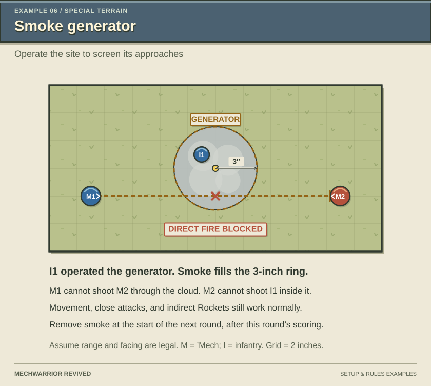

# Special terrain

Version 0.3 · Optional scenario rules

A working relay, smoke system, or coolant pump gives an objective another use. Troops can operate the site instead of moving or fighting.

Agree which sites are active before choosing armies. Use up to three, with at most one of each type. The [Live sites variant of Seize and Hold](01-seize-and-hold.md#live-sites-optional) uses all three.

## Operate

**Operate uses the whole activation.** The group stays still: no movement, turning, attacks, or other actions. Check these conditions before declaring it:

1. Choose one operator: a ’Mech, a vehicle, or one member of an infantry or battle armor squad. Its base center must be within **3 inches** of the site. It cannot be shutdown, in Salvage, or aboard a carrier. Zero attack or damage does not prevent operation.
2. Your army must control the site under the normal [objective rules](../rules/core-rules.md#10-objectives-and-victory). An enemy contesting it prevents operation. No member of the operating group may touch an enemy; a split squad must regroup first.
3. The line from the operator’s center to the site must not cross or touch blocking terrain. Facing, other bases, and smoke do not block this connection.

Resolve the site's effect without a roll, then mark the group activated. A squad gets **one use**, however many members are nearby; the others stay still. Salvaged members may stay with the squad but cannot be its operator.

Each site can be operated **once per round in total**, shared by both players. Put a Used marker beside it. At the start of the next round, remove Used markers and smoke before rolling initiative. Uplink claims remain.

### ’Mechs

Operate replaces both possible actions. It gains no heat and provides no Hold or Vent cooling. A ’Mech cannot Move then Operate, or Operate then Fire.

### Vehicles and infantry

Operate leaves readiness unchanged: it neither commits, pushes, nor recovers. A **Spent** group must recover instead. A Committed group stays Committed.

> **Example:** Three Committed infantry operate a smoke generator. One base works the controls; all three stay still and finish activated. The squad stays Committed and takes no pushing damage.

## Uplink

*The relay keeps transmitting your command codes after the troops move on.*

**Operate: claim the site.** Place your army's marker on it, replacing any previous claim.

If neither army has a unit eligible to control or contest within 3 inches, the claim controls the objective. Otherwise, use normal control rules. A claim cannot contest an enemy unit. Clear it if the enemy controls the site at the end of any activation; a contested site keeps its claim but scores for neither side.

Use the mission's normal scoring times and values. Uploading earns no immediate points, and remote control does not delay the core rule for ending an empty battlefield.

> **Example:** Blue claims the uplink, then leaves. With nobody nearby, Blue still scores it. A Red tank arrives alone: Red controls the site and clears Blue's claim. If the tank later leaves without operating, the site becomes uncontrolled.

## Smoke generator

*Emergency vents bury the site in a dense industrial fog.*

**Operate: release smoke within 3 inches of the site**, including the boundary. It lasts until the start of the next round, through this round's scoring.

Smoke blocks **direct ranged attacks** whose center-to-center line crosses or touches it, including shots starting or ending inside. This affects both armies, even when both models are in the cloud. Ignoring cover does not bypass smoke. Indirect Rockets work normally, with no extra smoke penalty.

Smoke adds no cover bonus or movement cost. Close attacks, objective control, and operating the site work normally.

> **Example:** A squad releases smoke, then an enemy ’Mech approaches. It cannot shoot the squad directly, but it can enter the cloud to contest the site or Assault into base contact.

## Coolant station

*Industrial pumps feed cold coolant into a BattleMech's heat exchangers.*

**Operate: remove 2 heat from one friendly ’Mech** whose base center is within 3 inches of the site. Stop at the green heat Start. The target must not touch an enemy, and its center-to-site connection must be clear of blocking terrain, just like the operator's. An operating ’Mech may cool itself.

The pump can restart a shutdown ’Mech. It does not heal damage, cause a stress roll, or clear an activation marker. Engineer adds nothing: this is not Vent. A restarted ’Mech that has not yet activated may take its normal activation later in the round.

> **Example:** A Ready vehicle operates the pump to cool an already-activated ’Mech from 3 heat to 1. The vehicle stays Ready. The ’Mech remains activated and cannot act again this round.

## Placing the sites

Use a small marker for each console, vent, or hose connection. It is a **point**, not a base or an obstacle. It cannot be attacked, captured with Bypass, or destroyed. The surrounding woods, fieldworks, or other terrain keep their usual rules.

Place each point where models can reach its 3-inch area and connect without crossing blocking terrain. A console beside a building belongs outside its footprint. Check access from both deployment zones before choosing sides.

Only sites identified as objectives by the scenario score points. A standalone smoke generator or coolant station uses the same control rules for operation but awards no points; an uplink must be a scoring objective. Site effects add no army points cost.

These rules are ready for playtesting. In the return game, swap sides and keep the same sites. Note whether a useful operation was worth giving up an activation.
